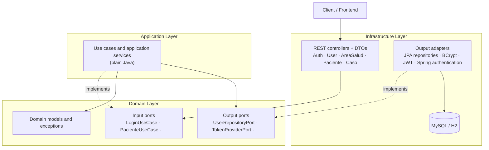
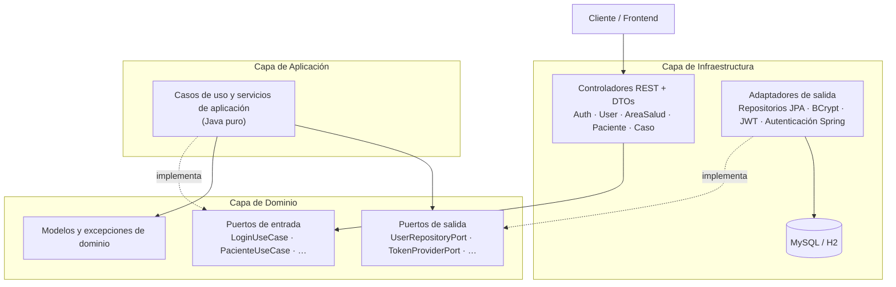

# Oropouche

**Epidemiological Case Management System and Clinical Decision Support for Oropouche Fever**

[English](#english) | [Español](#español)

---

## English

### Overview

Oropouche is a backend software project designed to manage and track Oropouche fever cases across different healthcare areas.

Its purpose is to centralize epidemiological and clinical information, help healthcare professionals evaluate reported cases, document medical assessments, and organize patient care plans and follow-up activities.

The system is designed as a clinical decision-support tool. Healthcare professionals remain responsible for evaluating each patient and making clinical decisions.

### Main objectives

- Manage healthcare areas and their associated cases.
- Maintain patient information and epidemiological records.
- Organize suspected, probable, and confirmed cases.
- Support clinical assessment and medical documentation.
- Record medical opinions and care plans.
- Track patient follow-up and case progress.
- Manage users and access roles.
- Provide information to support epidemiological monitoring.

### Architecture

The project is being developed using **Hexagonal Architecture (Ports and Adapters)** to separate business logic from infrastructure and external technologies.

The main architectural layers are:

- **Domain:** Business models, rules, and ports.
- **Application:** Use cases and application services.
- **Infrastructure:** REST controllers, persistence adapters, database entities, and security.

The hexagonal architecture is applied across all current modules: authentication, users, healthcare areas, patients, and Oropouche cases. The domain and application layers have no dependencies on Spring, JPA, or any other infrastructure technology; frameworks are only used in the infrastructure layer, which is connected to the use cases through ports.

### Architecture diagram

The following diagram illustrates how the layers interact in every module.



### Implemented modules

| Module | Endpoints | Notes |
|---|---|---|
| Authentication | `POST /auth/login` | Public. Returns a JWT. There is no public registration: users are created by the administrator. |
| Users | `GET /api/v1/user/me`, `GET /api/v1/user/{id}`, `PUT /api/v1/user` | Each user can only read and update their own personal data. |
| User administration | `/api/v1/admin/usuarios` | ADMIN only: create users, assign role and healthcare area, activate or deactivate, reset passwords. See [docs/roles-y-acceso.md](docs/roles-y-acceso.md). |
| Healthcare areas | `/api/v1/areas-salud` | Create, list (all / active), find by id or code, update, deactivate. |
| Patients | `/api/v1/pacientes` | Register, list (all / by area), find, update, deactivate. |
| Oropouche cases | `/api/v1/casos` | Register cases, laboratory results, and classification history. The system suggests the classification using PAHO case definitions; the professional decides. See [docs/modulo-casos.md](docs/modulo-casos.md). |
| Clinical care | `/api/v1/casos/{id}/…`, `/api/v1/desenlaces` | Clinical evaluations, medical opinions, care plans, follow-ups, case closure and reopening, follow-up schedule, and clinical alerts based on PAHO recommendations. Editable catalog of case outcomes. See [docs/modulo-clinico.md](docs/modulo-clinico.md). |

Business rules: a patient can only be assigned to a healthcare area that exists and is active; a patient can have only one open case; a case can only be confirmed with a positive confirmatory laboratory result; every classification change requires a reason and is recorded; clinical records are immutable (corrected with a new record). Records are deactivated, never deleted.

### Security

- Every endpoint except `/auth/**` requires a JWT (`Authorization: Bearer <token>`).
- Roles: `ADMIN` (users, healthcare areas, catalogs; no clinical data), `MEDICO` (patients, cases, and clinical care in their own healthcare area only), `EPIDEMIOLOGO` (all areas, validates classifications). The physician proposes the classification and the epidemiologist validates it.
- Missing, malformed, expired, or invalid tokens receive `401 Unauthorized`.
- Tokens are valid for 24 hours (configurable).
- Error responses do not expose internal details: `400` invalid data, `401` not authenticated, `403` not allowed for the role or healthcare area, `404` not found, `409` duplicate.

### Configuration and running locally

Secrets are not stored in the repository. They are provided through environment variables, or through an `application-local.properties` file in the project root, which is excluded from Git:

```bash
cp application-local.properties.example application-local.properties
# fill in DB_PASSWORD, JWT_SECRET (generate with: openssl rand -base64 32) and ADMIN_PASSWORD
./mvnw spring-boot:run
```

| Variable | Default | Description |
|---|---|---|
| `DB_HOST` / `DB_PORT` / `DB_NAME` | `localhost` / `3306` / `oropouchedb` | MySQL connection |
| `DB_USERNAME` / `DB_PASSWORD` | `root` / *(empty)* | MySQL credentials |
| `JWT_SECRET` | *(required)* | Base64 HMAC key, at least 256 bits |
| `JWT_EXPIRATION_MS` | `86400000` | Token validity (24 h) |
| `ADMIN_USERNAME` / `ADMIN_PASSWORD` | *(empty)* | First administrator, created at startup if there is no active ADMIN (password of at least 8 characters) |

### Technology stack

- **Language:** Java
- **Framework:** Spring Boot
- **Persistence:** Spring Data JPA, Hibernate
- **Security:** Spring Security
- **Build tool:** Maven
- **Databases:** MySQL and H2 Database
- **Testing:** JUnit and Mockito

### Testing

The project includes automated tests for use cases, application services, persistence adapters, REST controllers, and security rules (integration tests with H2).

Latest recorded validation: **149 tests executed, with no failures or errors.**

### Project status

**In development.**

The project is undergoing architectural improvements, domain modeling, and implementation of its epidemiological case-management functionality.

Not all the functional modules described in the objectives are implemented yet.

### Clinical considerations

Oropouche is intended to support epidemiological management and clinical assessment. It does not replace medical diagnosis, professional judgment, or treatment decisions.

### Repository

[GitHub - josuexpositoacosta/oropouche](https://github.com/josuexpositoacosta/oropouche)

---

## Español

### Descripción general

Oropouche es un proyecto de software backend diseñado para gestionar y realizar el seguimiento de casos de fiebre de Oropouche en las diferentes áreas de salud.

Su propósito es centralizar la información epidemiológica y clínica de los pacientes, facilitar el seguimiento de los casos y proporcionar herramientas de apoyo al personal médico para la evaluación, elaboración de dictámenes y planificación de la atención sanitaria.

El sistema está concebido como una herramienta de apoyo a la toma de decisiones clínicas. La evaluación de cada paciente y las decisiones médicas continúan siendo responsabilidad del personal sanitario.

### Objetivos principales

- Gestionar las áreas de salud y sus casos asociados.
- Mantener la información de los pacientes y sus registros epidemiológicos.
- Organizar los casos sospechosos, probables y confirmados.
- Apoyar la evaluación clínica y la documentación médica.
- Registrar dictámenes médicos y planes de atención.
- Dar seguimiento a los pacientes y a la evolución de los casos.
- Gestionar usuarios y roles de acceso.
- Proporcionar información para apoyar la vigilancia epidemiológica.

### Arquitectura

El proyecto se está desarrollando utilizando **Arquitectura Hexagonal (Puertos y Adaptadores)**, con el objetivo de separar las reglas de negocio de los mecanismos de persistencia, comunicación y servicios externos.

Las principales capas arquitectónicas son:

- **Dominio:** Modelos de dominio, reglas de negocio y puertos.
- **Aplicación:** Casos de uso y servicios de aplicación.
- **Infraestructura:** Controladores REST, adaptadores de persistencia, entidades de base de datos y seguridad.

La arquitectura hexagonal está aplicada en todos los módulos actuales: autenticación, usuarios, áreas de salud, pacientes y casos de Oropouche. Las capas de dominio y aplicación no dependen de Spring, JPA ni de ninguna otra tecnología de infraestructura; los frameworks solo se usan en la capa de infraestructura, que se conecta con los casos de uso a través de puertos.

### Diagrama de arquitectura

El siguiente diagrama representa cómo interactúan las capas en cada módulo.



### Módulos implementados

| Módulo | Endpoints | Notas |
|---|---|---|
| Autenticación | `POST /auth/login` | Público. Devuelve un JWT. No hay registro público: los usuarios los crea el administrador. |
| Usuarios | `GET /api/v1/user/me`, `GET /api/v1/user/{id}`, `PUT /api/v1/user` | Cada usuario solo consulta y modifica sus propios datos personales. |
| Administración de usuarios | `/api/v1/admin/usuarios` | Solo ADMIN: crear usuarios, asignar rol y área de salud, activar o desactivar y restablecer contraseñas. Ver [docs/roles-y-acceso.md](docs/roles-y-acceso.md). |
| Áreas de salud | `/api/v1/areas-salud` | Crear, listar (todas / activas), buscar por id o código, actualizar, desactivar. |
| Pacientes | `/api/v1/pacientes` | Registrar, listar (todos / por área), buscar, actualizar, desactivar. |
| Casos de Oropouche | `/api/v1/casos` | Registro de casos, resultados de laboratorio e historial de clasificación. El sistema sugiere la clasificación según las definiciones de caso de la OPS; decide el profesional. Ver [docs/modulo-casos.md](docs/modulo-casos.md). |
| Atención clínica | `/api/v1/casos/{id}/…`, `/api/v1/desenlaces` | Evaluaciones clínicas, dictámenes, planes de atención, seguimientos, cierre y reapertura del caso, agenda de controles y alertas clínicas basadas en las recomendaciones de la OPS. Catálogo editable de desenlaces. Ver [docs/modulo-clinico.md](docs/modulo-clinico.md). |

Reglas de negocio: un paciente solo puede asignarse a un área de salud existente y activa; un paciente solo puede tener un caso abierto; un caso solo se confirma con un resultado de laboratorio confirmatorio positivo; todo cambio de clasificación exige un motivo y queda registrado; los registros clínicos son inmutables (se corrigen con un registro nuevo). Los registros se desactivan, nunca se eliminan.

### Seguridad

- Todos los endpoints excepto `/auth/**` requieren un JWT (`Authorization: Bearer <token>`).
- Roles: `ADMIN` (usuarios, áreas de salud y catálogos; sin acceso a datos clínicos), `MEDICO` (pacientes, casos y atención clínica solo de su área de salud), `EPIDEMIOLOGO` (todas las áreas; valida clasificaciones). El médico propone la clasificación y el epidemiólogo la valida.
- Sin token, o con un token mal formado, caducado o inválido, se responde `401 Unauthorized`.
- Los tokens son válidos durante 24 horas (configurable).
- Las respuestas de error no exponen detalles internos: `400` datos inválidos, `401` no autenticado, `403` sin permiso por rol o área de salud, `404` no encontrado, `409` duplicado.

### Configuración y ejecución local

Los secretos no se guardan en el repositorio. Se proporcionan mediante variables de entorno, o mediante un archivo `application-local.properties` en la raíz del proyecto, que está excluido de Git:

```bash
cp application-local.properties.example application-local.properties
# rellenar DB_PASSWORD, JWT_SECRET (generar con: openssl rand -base64 32) y ADMIN_PASSWORD
./mvnw spring-boot:run
```

| Variable | Valor por defecto | Descripción |
|---|---|---|
| `DB_HOST` / `DB_PORT` / `DB_NAME` | `localhost` / `3306` / `oropouchedb` | Conexión a MySQL |
| `DB_USERNAME` / `DB_PASSWORD` | `root` / *(vacío)* | Credenciales de MySQL |
| `JWT_SECRET` | *(obligatoria)* | Clave HMAC en Base64, mínimo 256 bits |
| `JWT_EXPIRATION_MS` | `86400000` | Validez del token (24 h) |
| `ADMIN_USERNAME` / `ADMIN_PASSWORD` | *(vacío)* | Primer administrador, se crea al arrancar si no hay ningún ADMIN activo (contraseña de al menos 8 caracteres) |

### Tecnologías

- **Lenguaje:** Java
- **Framework:** Spring Boot
- **Persistencia:** Spring Data JPA, Hibernate
- **Seguridad:** Spring Security
- **Gestión de construcción:** Maven
- **Bases de datos:** MySQL y H2 Database
- **Pruebas:** JUnit y Mockito

### Pruebas

El proyecto dispone de pruebas automatizadas para casos de uso, servicios de aplicación, adaptadores de persistencia, controladores REST y reglas de seguridad (pruebas de integración con H2).

Última validación registrada: **149 pruebas ejecutadas, sin fallos ni errores.**

### Estado del proyecto

**En desarrollo.**

El proyecto se encuentra en evolución, con mejoras arquitectónicas, modelado del dominio e implementación progresiva de las funcionalidades de gestión epidemiológica.

No todos los módulos funcionales descritos en los objetivos están implementados todavía.

### Consideraciones clínicas

Oropouche está concebido como una herramienta de apoyo a la gestión epidemiológica y a la evaluación clínica. No sustituye el diagnóstico médico, el criterio profesional ni las decisiones terapéuticas del personal sanitario.

### Repositorio

[GitHub - josuexpositoacosta/oropouche](https://github.com/josuexpositoacosta/oropouche)

---

**Author:** [Josué Exposito Acosta](https://github.com/josuexpositoacosta)