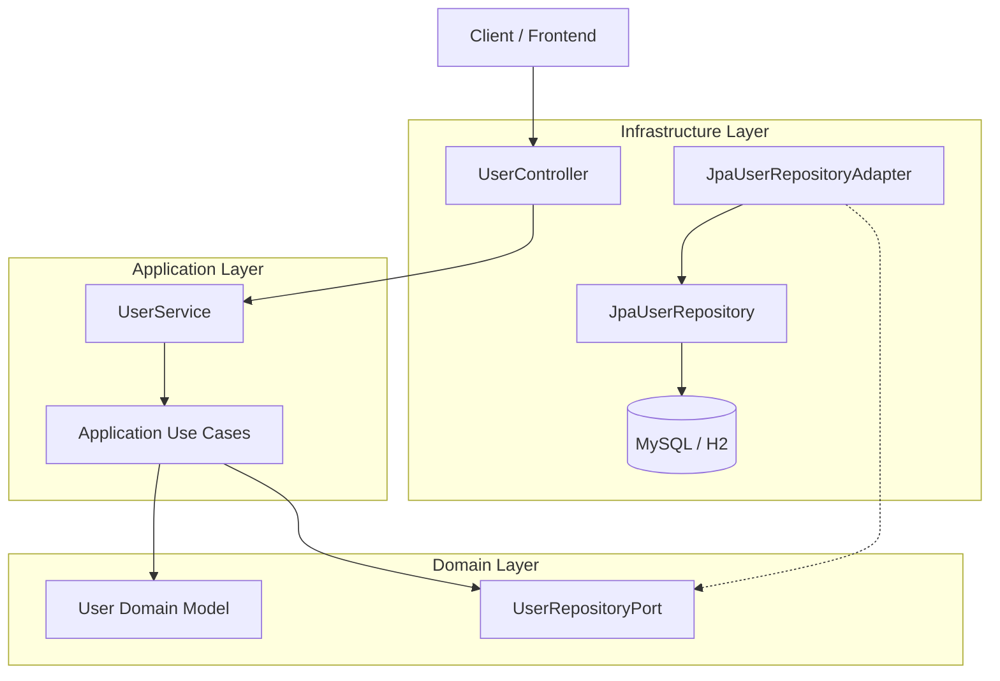
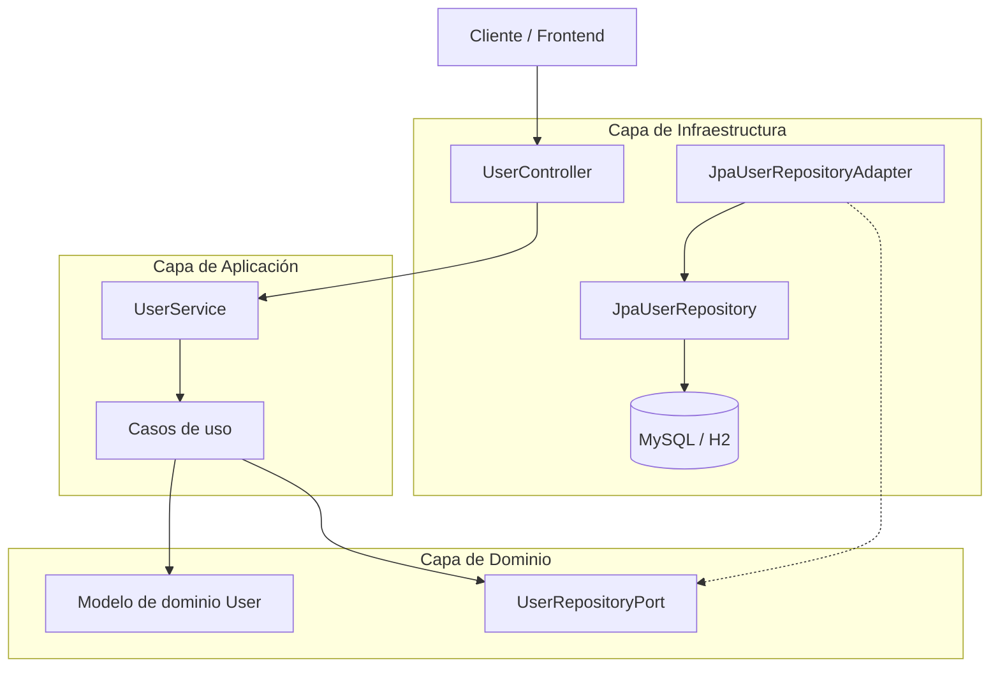

# Oropouche

**Epidemiological Case Management System and Clinical Decision Support for Oropouche Fever**

[English](#english) | [Español](#español)

---

## English

### Overview

Oropouche is a backend software project designed to manage and track Oropouche fever cases across different healthcare areas.

Its purpose is to centralize epidemiological and clinical information, help healthcare professionals evaluate reported cases, document medical assessments, and organize patient care plans and follow-up activities.

The system is designed as a clinical decision-support tool. Healthcare professionals remain responsible for evaluating each patient and making clinical decisions.

### Main objectives

- Manage healthcare areas and their associated cases.
- Maintain patient information and epidemiological records.
- Organize suspected, probable, and confirmed cases.
- Support clinical assessment and medical documentation.
- Record medical opinions and care plans.
- Track patient follow-up and case progress.
- Manage users and access roles.
- Provide information to support epidemiological monitoring.

### Architecture

The project is being developed using **Hexagonal Architecture (Ports and Adapters)** to separate business logic from infrastructure and external technologies.

The main architectural layers are:

- **Domain:** Business models, rules, and ports.
- **Application:** Use cases and application services.
- **Infrastructure:** REST controllers, persistence adapters, database entities, and security.

The hexagonal architecture has been implemented particularly in the user management module and is part of the ongoing architectural evolution of the project.

### Architecture diagram

The following diagram illustrates the architecture currently implemented in the user management module.

### Technology stack

- **Language:** Java
- **Framework:** Spring Boot
- **Persistence:** Spring Data JPA, Hibernate
- **Security:** Spring Security
- **Build tool:** Maven
- **Databases:** MySQL and H2 Database
- **Testing:** JUnit and Mockito

### Testing

The project includes automated tests for application components, persistence, and REST controllers.

Latest recorded validation: **28 tests executed, with no failures or errors.**

### Project status

**In development.**

The project is undergoing architectural improvements, domain modeling, and implementation of its epidemiological case-management functionality.

Not all the functional modules described in the objectives are implemented yet.

### Clinical considerations

Oropouche is intended to support epidemiological management and clinical assessment. It does not replace medical diagnosis, professional judgment, or treatment decisions.

### Repository

[GitHub - josuexpositoacosta/oropouche](https://github.com/josuexpositoacosta/oropouche)

---

## Español

### Descripción general

Oropouche es un proyecto de software backend diseñado para gestionar y realizar el seguimiento de casos de fiebre de Oropouche en las diferentes áreas de salud.

Su propósito es centralizar la información epidemiológica y clínica de los pacientes, facilitar el seguimiento de los casos y proporcionar herramientas de apoyo al personal médico para la evaluación, elaboración de dictámenes y planificación de la atención sanitaria.

El sistema está concebido como una herramienta de apoyo a la toma de decisiones clínicas. La evaluación de cada paciente y las decisiones médicas continúan siendo responsabilidad del personal sanitario.

### Objetivos principales

- Gestionar las áreas de salud y sus casos asociados.
- Mantener la información de los pacientes y sus registros epidemiológicos.
- Organizar los casos sospechosos, probables y confirmados.
- Apoyar la evaluación clínica y la documentación médica.
- Registrar dictámenes médicos y planes de atención.
- Dar seguimiento a los pacientes y a la evolución de los casos.
- Gestionar usuarios y roles de acceso.
- Proporcionar información para apoyar la vigilancia epidemiológica.

### Arquitectura

El proyecto se está desarrollando utilizando **Arquitectura Hexagonal (Puertos y Adaptadores)**, con el objetivo de separar las reglas de negocio de los mecanismos de persistencia, comunicación y servicios externos.

Las principales capas arquitectónicas son:

- **Dominio:** Modelos de dominio, reglas de negocio y puertos.
- **Aplicación:** Casos de uso y servicios de aplicación.
- **Infraestructura:** Controladores REST, adaptadores de persistencia, entidades de base de datos y seguridad.

La arquitectura hexagonal ya está implementada especialmente en el módulo de gestión de usuarios y forma parte de la evolución arquitectónica del proyecto.

### Diagrama de arquitectura

El siguiente diagrama representa la arquitectura implementada actualmente en el módulo de gestión de usuarios.

### Tecnologías

- **Lenguaje:** Java
- **Framework:** Spring Boot
- **Persistencia:** Spring Data JPA, Hibernate
- **Seguridad:** Spring Security
- **Gestión de construcción:** Maven
- **Bases de datos:** MySQL y H2 Database
- **Pruebas:** JUnit y Mockito

### Pruebas

El proyecto dispone de pruebas automatizadas para componentes de aplicación, persistencia y controladores REST.

Última validación registrada: **28 pruebas ejecutadas, sin fallos ni errores.**

### Estado del proyecto

**En desarrollo.**

El proyecto se encuentra en evolución, con mejoras arquitectónicas, modelado del dominio e implementación progresiva de las funcionalidades de gestión epidemiológica.

No todos los módulos funcionales descritos en los objetivos están implementados todavía.

### Consideraciones clínicas

Oropouche está concebido como una herramienta de apoyo a la gestión epidemiológica y a la evaluación clínica. No sustituye el diagnóstico médico, el criterio profesional ni las decisiones terapéuticas del personal sanitario.

### Repositorio

[GitHub - josuexpositoacosta/oropouche](https://github.com/josuexpositoacosta/oropouche)

---

**Author:** [Josué Exposito Acosta](https://github.com/josuexpositoacosta)